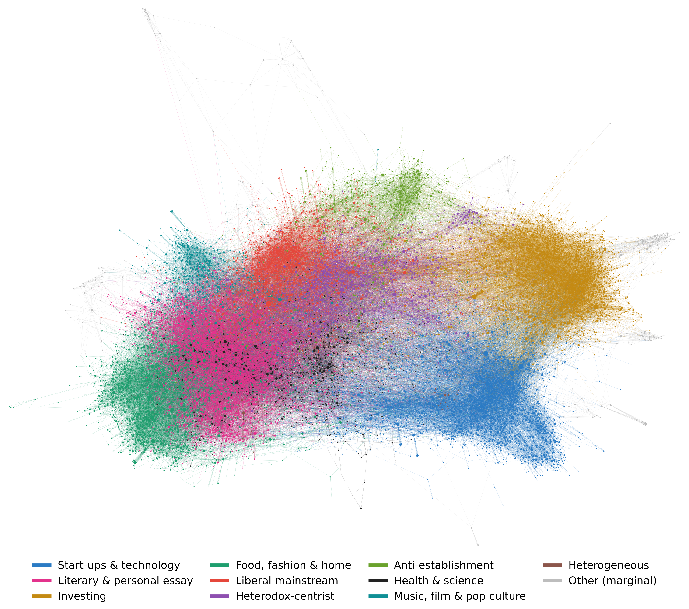

# Beyond Topics: Uncovering Subcommunities in Substack's Recommendation Network

> **Sara Rossi** | Social Network Analysis, University of Pisa (2025/26)  
> *Individual Project • Student ID: 637107*

## Open Problem

On Substack, a recommendation is not just an algorithmic suggestion; it is a deliberate editorial endorsement. When authors recommend another newsletter, they actively direct their hard-earned readership elsewhere. 

This project maps that web of endorsements from scratch to answer one compelling question:

> ### Do newsletters recommend based on *what* they write about, or *who* they agree with?

---

## Methodology

1. **Data Collection**: Executed a breadth-first snowball crawl starting from 15 seed newsletters across 5 domains (literature, politics, technology, finance, health), mapping a network of **15,186 newsletters** and **103,425 recommendations**.
2. **Topic Inference**: Inferred newsletter topics using TF–IDF and *k*-means clustering on recent post titles and subtitles, then refined the results using post bodies and a custom keyword dictionary.
3. **Network Characterization**: Analyzed degree distribution, path lengths, clustering, and centrality, benchmarking the real-world network against Erdős–Rényi and Barabási–Albert null models.
4. **Communities vs. Topics**: Detected communities using the Louvain algorithm (with Leiden stability checks) and compared them against inferred topics, validating significance through a label-permutation null model and deep-dive community inspection.

---

## Key Findings

- **Small-World and Heavy-Tailed**: The network exhibits short path lengths (similar to a random graph) but with a clustering coefficient approximately 200 times higher.
- **Topic Rules (Mostly)**: In domains like finance and food, recommendations are highly topical. About 90% of newsletters on these subjects fall neatly into a single, dominant community.
- **Ideology Overrides Topic**: When positions conflict, topic alone is not enough to explain the network. 
  - *Politics* fractures into three distinct communities (liberal mainstream, heterodox-centrist, and anti-establishment) that cut across finer political sub-topics.
  - *Health* newsletters critical of COVID-19 vaccines are recommended alongside anti-establishment political commentary, rather than alongside mainstream public-health newsletters.

---

## Tech Stack and Tools

- **Python**: `networkx`, `igraph`, `leidenalg`, `powerlaw`, `scikit-learn`, `langdetect`
- **Data Acquisition**: Unofficial [`substack-api`](https://github.com/NHagar/substack_api)
- **Visualization**: Gephi (for network layout and rendering)

